# Kinetone

**Gestural music gloves, built at HackUMass 2026 by August Koskinen and Liam Downing.**

Kinetone is a two-handed wearable instrument. You play notes by touching copper pads on your fingertips to your thumb, the way you'd finger a sax. Rolling your right hand bends the pitch. The gloves send everything wirelessly to a Bela board, which makes the sound in real time.

<p align="center">
  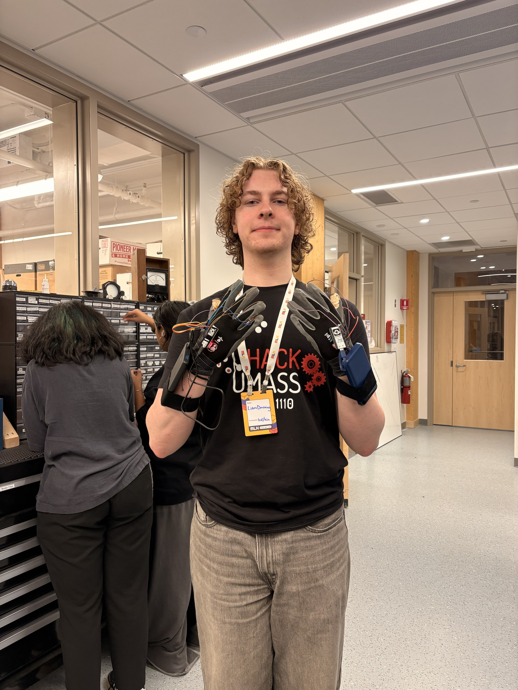
  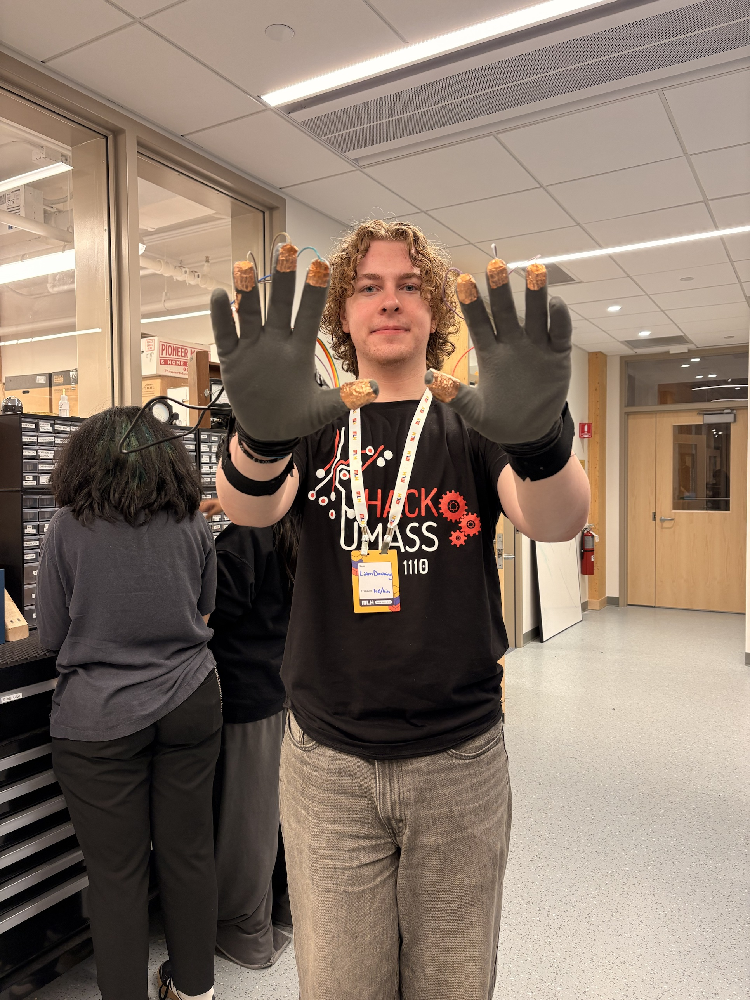
</p>

---

## How it works

```
 LEFT GLOVE (ESP32)          RIGHT GLOVE (ESP32 + IMU)
 3 finger contacts           4 finger contacts + roll + motion
        \                          /
         \     ESP-NOW radio      /
          \   (2.4 GHz, ch. 1)   /
           v                    v
          RECEIVER ESP32  ── USB serial, 115200 ──>  BELA
                                                    finger pattern -> note
                                                    right-hand roll -> pitch bend
                                                    sax-style additive synth -> audio out
```

1. **The gloves.** Each glove has an ESP32 on the back of the hand, powered by a small USB power bank strapped to the wrist. Copper tape pads on the fingertips are wired to input pins with internal pull-ups. Touching a pad to the grounded thumb pad closes the contact. The right glove also has an IMU (Pololu MinIMU-9 v2) that measures how far the hand is rolled and how hard it's moving.
2. **The receiver.** A third ESP32 collects both gloves' packets over ESP-NOW and passes them to the Bela as plain text lines over USB.
3. **The Bela.** The Bela turns the seven finger contacts (3 left + 4 right) into a note, applies a pitch bend from the right-hand roll, and synthesizes a reed-like tone.

Both gloves run **the same transmitter sketch**. The only difference is one setting at the top: `#define HAND_ID 0` for left, `1` for right.

---

## Hardware

| Part | Left glove | Right glove | Receiver |
|---|---|---|---|
| Microcontroller | ESP32 Dev Module | ESP32 Dev Module | ESP32 Dev Module |
| Finger contacts | Index, middle, ring (GPIO 25, 26, 27) | Index, middle, ring, pinky (GPIO 25, 26, 27, 14) | none |
| IMU | none | Pololu MinIMU-9 v2 (I²C: SDA 21, SCL 22, VIN to 3V3) | none |
| Power | USB power bank | USB power bank | USB from the Bela |

The code also supports an MPU6050 (GY-521) and detects which IMU is connected at startup.

<p align="center">
  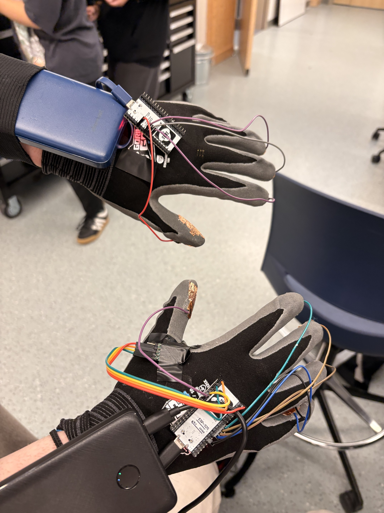
  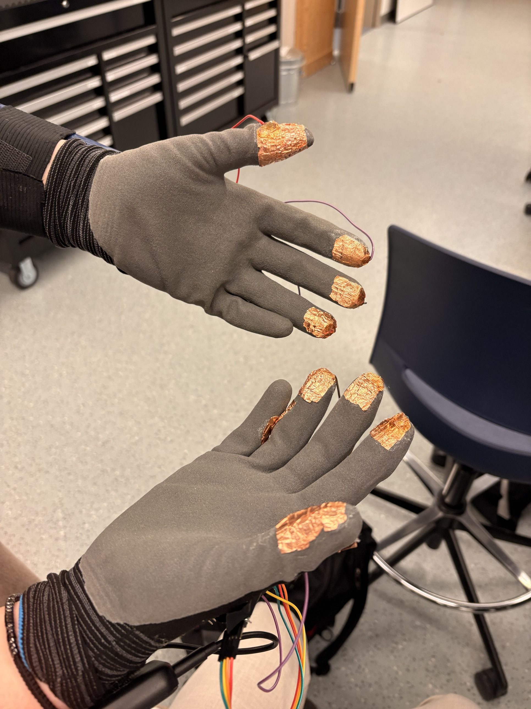
</p>

**Wiring notes we learned the hard way:**
- Never wire anything to the ESP32's `SD0–SD3`, `CLK` or `CMD` pins (GPIO 6–11). They connect to the flash chip. Doing this corrupted our boards and made both IMUs look dead when they were fine.
- On the Pololu MinIMU-9 v2, connect VIN to **3V3**, not 5V, so its I²C lines match the ESP32's 3.3 V logic.
- The code is built to survive flaky glove wiring. It filters out spikes, rejects impossible readings, and re-initializes the IMU and I²C bus automatically after a dropout.

---

## Data format (receiver to Bela)

Every 20 ms:
```
LEFT,1110,0,0
RIGHT,1000,-42,17
```
`HAND,fingers,roll,motion`
- **fingers:** index, middle, ring, pinky (`1` = touching)
- **roll:** −180 to 180. `0` is anywhere within ±20° of palm-down. It ramps to ±180 at the limits you recorded during calibration. Clockwise is positive.
- **motion:** 0 to 100 movement intensity, with gravity removed and about 300 ms of decay.

Setup messages:
```
STATUS,LEFT,PROMPT,2
EVENT,RIGHT,STEP_DONE
INFO,Receiver started (reset reason: POWER-ON)
```

The Bela sends commands back the other way: `CMD,<SETUP|FULL>,<LEFT|RIGHT|BOTH>`.

---

## Playing

Notes come from the 7-character finger pattern: left index, middle and ring, then right index, middle, ring and pinky. The current mapping (`liamMap` in the Bela code):

| Fingers (L L L R R R R) | Note |
|---|---|
| `0000000` | rest |
| `0010000` | B4 |
| `0100000` | A#4 |
| `1000000` | A4 |
| `1001000` | G#4 |
| `1100000` | G4 |
| `1110001` | F#4 |
| `1110000` | F4 |
| `1110100` | E4 |
| `1111000` | D#4 |
| `1111100` | D4 |
| `1111111` | C#4 |
| `1111110` | C4 |

**Pitch bend:** rolling the right hand fully counterclockwise (−180) bends the note down a half step, and fully clockwise (+180) bends it up a half step. The bend is smoothed with a two-stage 60 ms glide, so it sounds continuous rather than stepped.

The Bela code also includes `tenorSaxMapping` and `testMapping`. Switch to one of them with `mapping = ...` in `setup()`.

---

## Setup and calibration

You can't see a serial monitor while you're wearing the gloves, so setup is guided by **tones from the Bela**. The left glove gets lower tones (440 Hz) and the right glove gets higher ones (880 Hz).

1. Power on the receiver, the Bela and both gloves. The instrument stays muted until setup is done.
2. The left glove goes first. Its prompt repeats every 6 seconds: **N beeps = step N**.
3. Get into the position for that step, then **tap your index finger** to measure it. Hold still while it ticks.
   - **Rising chime:** step done.
   - **Low buzz:** you moved, so that step will repeat.
4. When the left glove finishes, the right glove starts. When every connected glove is ready, a fanfare plays and the instrument switches on.

**Quick setup** (every start) just re-zeroes palm-down. **Full calibration** also records your clockwise and counterclockwise roll limits and your hardest shake. All calibration is saved in the glove's flash memory.

To start a **full calibration** at power-up, hold all fingers for 2 s, release, then hold again for 2 s.

**From the Bela IDE console** (no need to power-cycle the gloves you're wearing):
```
echo setup > /tmp/glove          # re-zero both gloves
echo setup left > /tmp/glove     # re-zero one glove
echo full > /tmp/glove           # full calibration, both gloves
echo full right > /tmp/glove     # full calibration, one glove
echo status > /tmp/glove         # show each glove's state
```

---

## Repository layout

| Path | What it is |
|---|---|
| `GloveTransmitter.ino` | Glove firmware, shared by both hands (set `HAND_ID`) |
| `GloveReciever.ino` | Receiver ESP32 firmware |
| `Bela/` | Bela project: serial reader, setup guide tones, note mapping, synth |
| `media/` | Build photos and test videos |

**Building:**
- **ESP32 sketches:** Arduino IDE with the ESP32 core (board: *ESP32 Dev Module*). The glove sketch needs the Pololu `L3G` and `LSM303` libraries. Leave *Erase All Flash Before Sketch Upload* **disabled**, or the saved calibration is wiped.
- **Bela:** open the `Bela/` project in the Bela IDE and run it. Plug the receiver into the Bela's USB host port.

---

## Build log

<p align="center">
  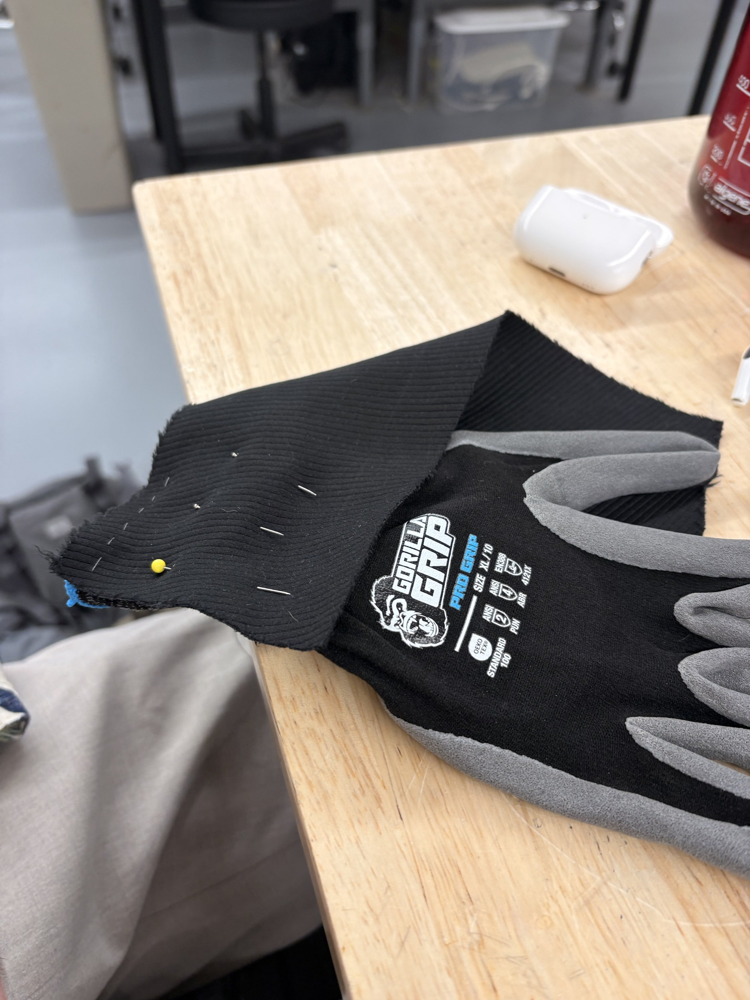
  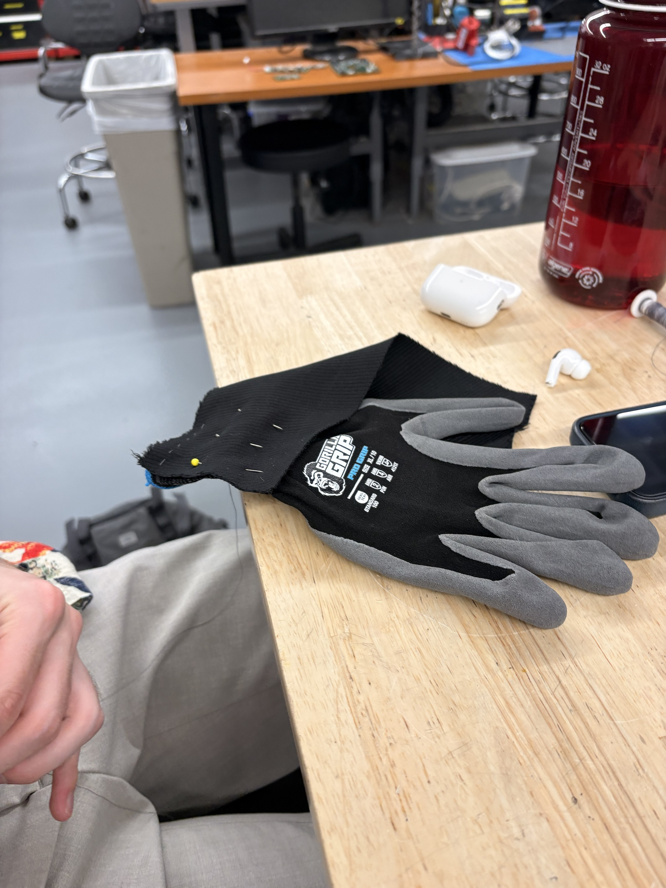
  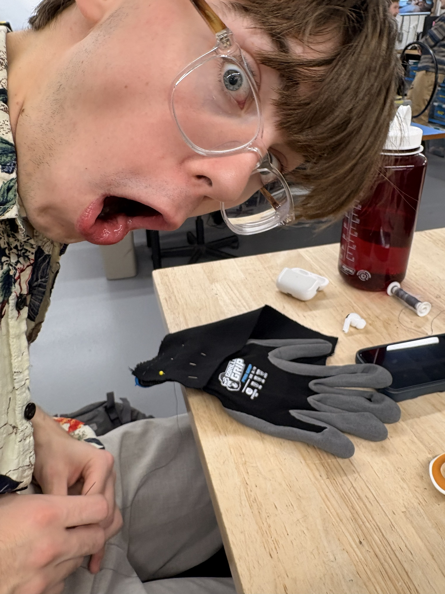
</p>
<p align="center">
  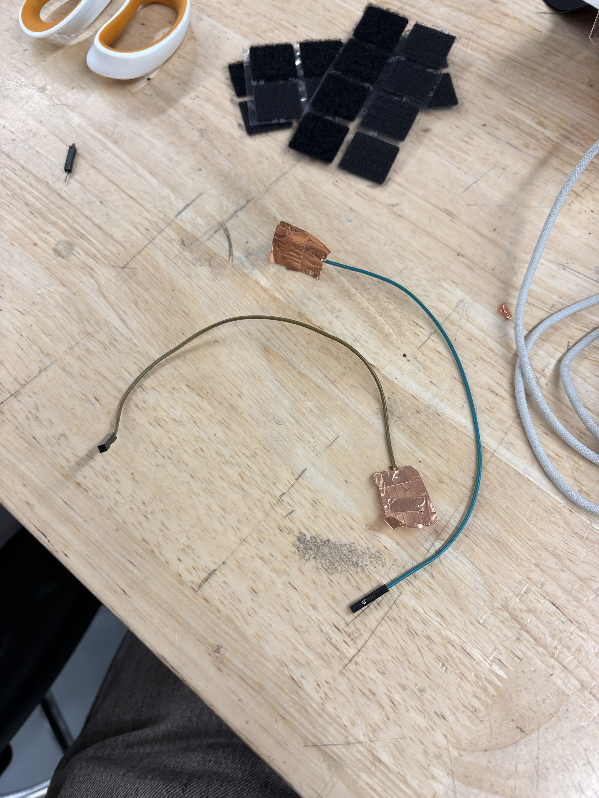
  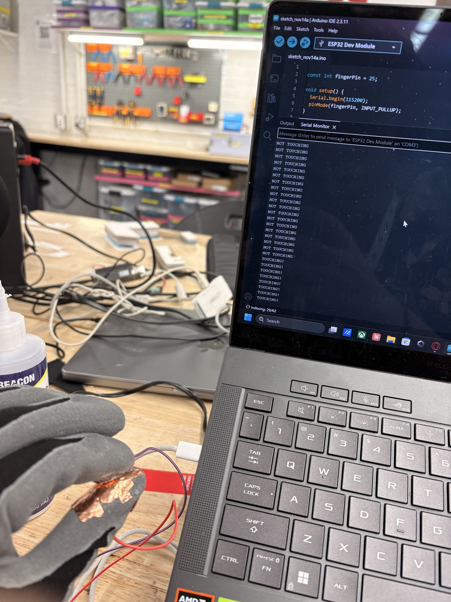
  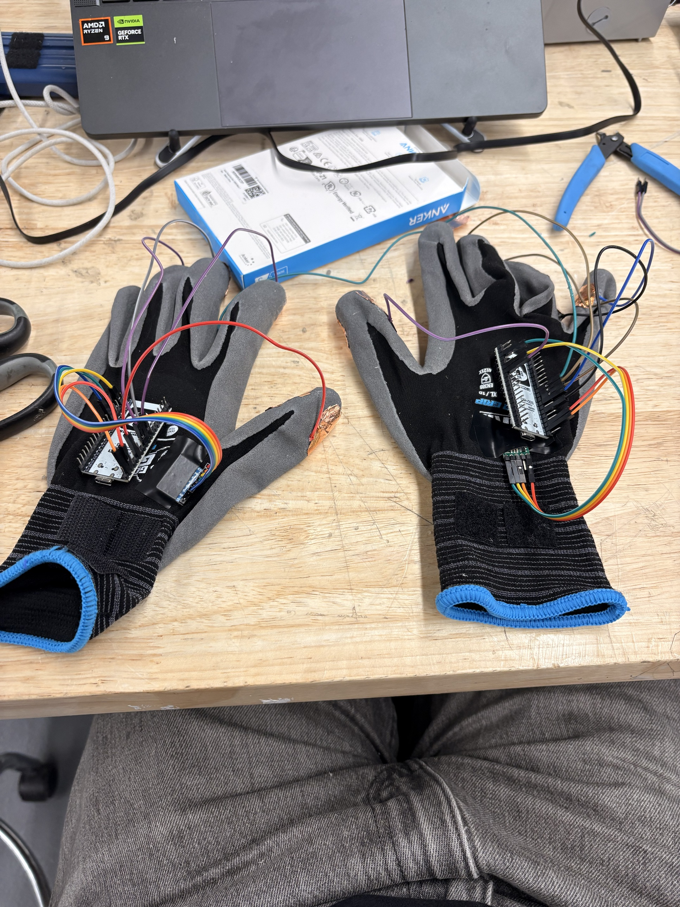
</p>
<p align="center">
  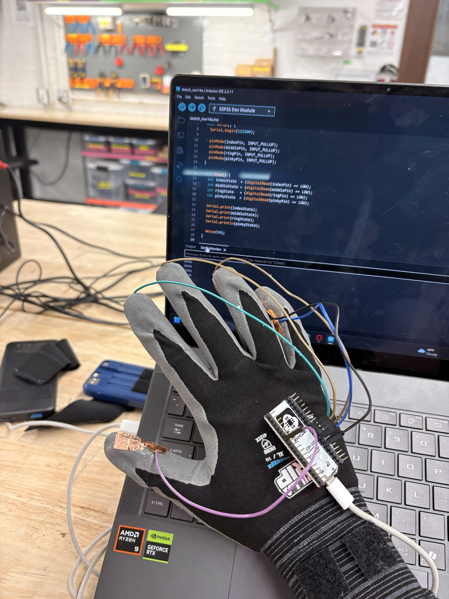
  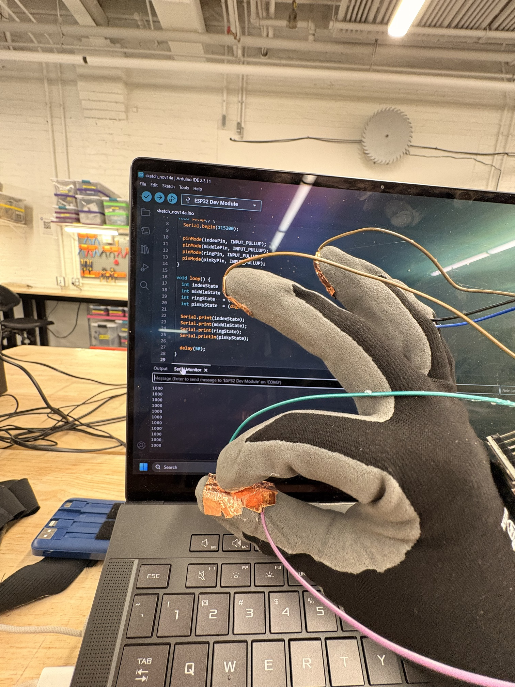
  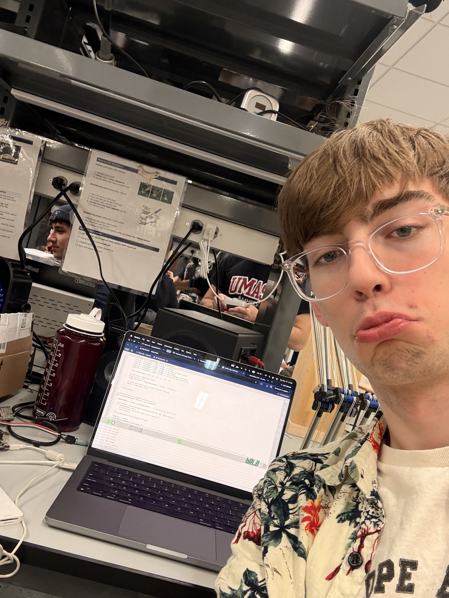
</p>

**Videos:**
- [Finger contact test 1](media/videos/finger-contact-test-1.mov)
- [Finger contact test 2](media/videos/finger-contact-test-2.mov)
- [Four-finger test](media/videos/four-finger-test.mov)
- [Clip](media/videos/clip.mov)

---

## Team

- **August Koskinen:** Bela audio engine, synthesis and note mapping
- **Liam Downing:** gloves, ESP32 firmware, calibration and wireless link
